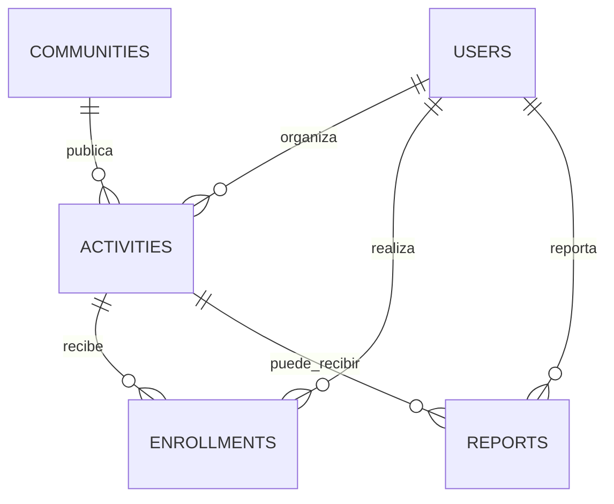

# Base inicial de EntornoActivo

La base se llamará `entornoactivo`. El modelo sigue el proyecto: usuarios, comunidades, actividades, inscripciones y reportes. El archivo `init-mongodb.js` crea las colecciones con validaciones e índices; no agrega registros de personas.



## Colecciones

- **users**: nombre, correo, tipo de usuario y datos básicos del perfil. La autorización de organizador se guarda como estado pendiente/aprobado/rechazado. Si se añade autenticación en el servidor, solo se guarda un hash de contraseña, nunca la contraseña original.
- **communities**: escuelas y comunidades participantes.
- **activities**: comunidad, título, categoría, fecha, lugar general, cupo, organizador y estado (borrador, pendiente de aprobación, publicada, rechazada, cancelada o finalizada).
- **enrollments**: relación entre una persona y una actividad, con estado activo/cancelado. Un índice impide tener dos inscripciones activas de la misma persona para la misma actividad.
- **reports**: situaciones que requieren revisión.

Las relaciones usan identificadores `ObjectId`. El prototipo aún no se conecta a esta base ni debe cargarse con datos reales de estudiantes.

## Crear la base desde Compass

Compass es la interfaz para administrar MongoDB; necesita conectarse a un MongoDB Server que esté funcionando. En este equipo no se encontró el servidor local (`mongod`). Cuando esté instalado y activo:

1. En Compass crea una conexión con `mongodb://127.0.0.1:27017` y pulsa **Connect**.
2. En la conexión, elige **Create Database**.
3. Usa `entornoactivo` como nombre y `communities` como primera colección.
4. Las otras colecciones se crean con el inicializador de abajo, que también agrega validaciones e índices.

## Aplicar las colecciones, reglas e índices

Con MongoDB Server y `mongosh` instalados y el servidor local activo, abre una terminal en la carpeta del proyecto y ejecuta:

```powershell
npm run db:init
```

También puedes ejecutar directamente `mongosh --file database/init-mongodb.js`. El inicializador no inserta documentos.

## Siguiente etapa

Después de crear la base, se conectará una API local de Node.js y GraphQL. Luego la web reemplazará gradualmente `localStorage` por esa API. Hasta entonces, Login es una demostración y la base no participa en el funcionamiento del sitio.
